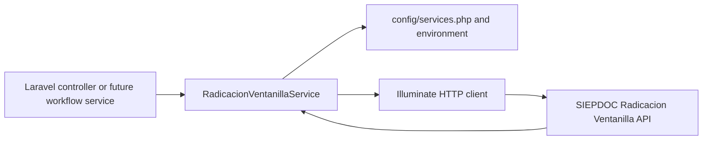

# AI Handoff Context — Radicación de Ventanilla Integration

## Document purpose

This document is a handoff for future AI sessions and model switches working on the Radicación de Ventanilla / SIEPDOC integration in the Laravel application.

It describes the current implementation, the decisions made during the feature work, the provider contracts collected from the Swagger export and user-supplied documentation, and the known gaps that must be addressed before production use.

## 1. Feature Summary

The feature adds a Laravel service for the external SIEPDOC Radicación de Ventanilla API. The service is [`App\Services\RadicacionVentanillaService`](../../images/php/laravel/app/Services/RadicacionVentanillaService.php:10).

The current service supports:

- Generic radication through `POST /api/radicacion/radicar`.
- Explicit opening-radicado behavior through [`openRadicado()`](../../images/php/laravel/app/Services/RadicacionVentanillaService.php:62).
- Explicit closing-radicado behavior through [`closeRadicado()`](../../images/php/laravel/app/Services/RadicacionVentanillaService.php:79).
- Principal-document upload through `POST /api/radicacion/documento/principal`.
- Annex-document upload through `POST /api/radicacion/documento/anexos`.
- Radicado consultation through `POST /api/radicacion/consultar/radicado`.
- Radicado state changes through `POST /api/radicacion/registro/estado`.

The provider template endpoint `POST /api/radicacion/documento/plantilla` is documented but intentionally not implemented.

## 2. Business Problem

The application needs to integrate its trámite workflow with an external document-management and radication provider. The external system creates the official radicado number, accepts the source citizen/document data, associates the principal document and annexes, supports later consultation, and allows the application to advance the radicado through provider-controlled states.

The business workflow has two radication phases:

1. **Opening radicado**: create the initial radicado with `tipoRadicado = 1` and no antecedent.
2. **Closing radicado**: create a second radicado with `tipoRadicado = 2` and `antecedente` set to the opening radicado returned by the first request.

The generated provider radicado must be retained because it is required by subsequent document, consultation, and state-change operations.

## 3. Requirements Implemented

### Service and configuration

- Added [`RadicacionVentanillaService`](../../images/php/laravel/app/Services/RadicacionVentanillaService.php:10) under the Laravel `App\Services` namespace.
- Added environment-backed provider configuration in [`config/services.php`](../../images/php/laravel/config/services.php:38).
- Added empty configuration placeholders in [`.env.example`](../../images/php/laravel/.env.example:71).
- Kept the provider password out of PHP source, configuration defaults, and documentation.
- Allowed constructor-level configuration injection for testability while defaulting to Laravel configuration.

### Radication

- [`radicar()`](../../images/php/laravel/app/Services/RadicacionVentanillaService.php:49) sends a JSON request and returns the complete decoded provider response.
- [`openRadicado()`](../../images/php/laravel/app/Services/RadicacionVentanillaService.php:62) overrides caller values with `tipoRadicado = 1` and `antecedente = null`, then returns only `vo.radicado`.
- [`closeRadicado()`](../../images/php/laravel/app/Services/RadicacionVentanillaService.php:79) overrides caller values with `tipoRadicado = 2` and `antecedente = $openRadicado`, then returns only `vo.radicado`.
- Opening and closing methods throw when the expected nested radicado is missing or empty.

### Document uploads

- [`uploadDocumentoPrincipal()`](../../images/php/laravel/app/Services/RadicacionVentanillaService.php:123) accepts a transaction reference, radicado, and local filesystem path.
- The principal document is attached as a raw multipart field named `file`.
- [`uploadAnexos()`](../../images/php/laravel/app/Services/RadicacionVentanillaService.php:137) accepts a transaction reference, radicado, and multiple local paths.
- Annexes are attached as repeated raw multipart fields named `files`.
- Both upload methods return only `vo.datosdocumento` and throw when that response property is absent or malformed.
- The original intermediate base64 JSON approach was superseded by the later official `File` / multipart documentation.

### Consultation and state

- [`consultarRadicado()`](../../images/php/laravel/app/Services/RadicacionVentanillaService.php:94) sends the provider credentials, `referencia`, and `radicado` as JSON and returns the complete decoded response.
- [`cambiarEstado()`](../../images/php/laravel/app/Services/RadicacionVentanillaService.php:109) sends credentials, `referencia`, `radicado`, and `estado` as JSON and returns the complete decoded response.
- Valid state names are deliberately not hardcoded because the entity controls the allowed values per radicado type.

## 4. Architecture Overview

### Application structure

The application is Laravel 11 / PHP 8.2, as declared in [`composer.json`](../../images/php/laravel/composer.json:11). The integration is implemented as an application service rather than a controller-specific HTTP call.



### Service internals

The service has two request paths:

- [`postJson()`](../../images/php/laravel/app/Services/RadicacionVentanillaService.php:149) uses `acceptJson()`, `asJson()`, and `post()` for radication, consultation, and state changes.
- [`postMultipart()`](../../images/php/laravel/app/Services/RadicacionVentanillaService.php:171) uses Laravel HTTP `attach()` for principal and annex files, then posts form fields plus credentials.

Shared helper responsibilities:

- [`credentials()`](../../images/php/laravel/app/Services/RadicacionVentanillaService.php:195) builds the four configured provider credential fields.
- [`extractRadicado()`](../../images/php/laravel/app/Services/RadicacionVentanillaService.php:205) extracts and validates `vo.radicado`.
- [`readFile()`](../../images/php/laravel/app/Services/RadicacionVentanillaService.php:224) validates and reads a local file for multipart attachment.
- [`extractDatosDocumento()`](../../images/php/laravel/app/Services/RadicacionVentanillaService.php:242) extracts and validates `vo.datosdocumento`.

### Credential precedence

The service merges caller payload fields with configured credentials using the configured credentials as the final values. A caller cannot accidentally override `usuario`, `password`, `aplicativo`, or `operador` through a payload.

## 5. Files Created

### [`images/php/laravel/app/Services/RadicacionVentanillaService.php`](../../images/php/laravel/app/Services/RadicacionVentanillaService.php)

The main integration service. It was created during this feature and now contains the JSON and multipart endpoint implementations described above.

### [`dev/radicado_api/internal_docs.md`](../radicado_api/internal_docs.md)

Internal endpoint notes consolidating the Swagger export and the additional provider documentation supplied during implementation. It contains request tables, response examples, workflow notes, and security guidance.

### [`dev/context/AI_CONTEXT.md`](./AI_CONTEXT.md)

This handoff document.

## 6. Files Modified

### [`images/php/laravel/config/services.php`](../../images/php/laravel/config/services.php)

Added the `radicacion_ventanilla` configuration block:

- `base_url`
- `username`
- `password`
- `application`
- `operator`

All values come from environment variables.

### [`images/php/laravel/.env.example`](../../images/php/laravel/.env.example)

Added empty placeholders:

```text
RADICACION_VENTANILLA_BASE_URL=
RADICACION_VENTANILLA_USERNAME=
RADICACION_VENTANILLA_PASSWORD=
RADICACION_VENTANILLA_APPLICATION=
RADICACION_VENTANILLA_OPERATOR=
```

### Existing files inspected but not intentionally modified by this feature

- [`images/php/laravel/app/Http/Controllers/SolicitudController.php`](../../images/php/laravel/app/Http/Controllers/SolicitudController.php)
- [`images/php/laravel/app/Http/Controllers/DocumentoController.php`](../../images/php/laravel/app/Http/Controllers/DocumentoController.php)
- [`dev/radicado_api/api_swagger.html`](../radicado_api/api_swagger.html)
- [`dev/radicado_api/creds.txt`](../radicado_api/creds.txt)

The working tree showed unrelated modifications in controller and local environment files during the feature work. Those changes must be reviewed separately and must not be attributed to this service implementation without checking version-control history.

## 7. Database Changes

No migrations, tables, indexes, models, repositories, or database seeders were added or modified for this feature.

The service returns provider data to callers but does not persist:

- Opening radicados.
- Closing radicados.
- Provider responses.
- Uploaded document metadata.
- State changes.

The existing application has `solicitudes`, `documentos`, and related tables, but integrating those tables with this service remains future work.

## 8. API Changes

There are no new inbound Laravel routes or controllers. This feature adds outbound calls to the external API.

### Outbound endpoint matrix

| Service method | HTTP method | Provider path | Encoding | Return value |
|---|---|---|---|---|
| `radicar()` | POST | `/api/radicacion/radicar` | JSON | Complete decoded response |
| `openRadicado()` | POST | `/api/radicacion/radicar` | JSON | `vo.radicado` string |
| `closeRadicado()` | POST | `/api/radicacion/radicar` | JSON | `vo.radicado` string |
| `uploadDocumentoPrincipal()` | POST | `/api/radicacion/documento/principal` | Multipart, field `file` | `vo.datosdocumento` |
| `uploadAnexos()` | POST | `/api/radicacion/documento/anexos` | Multipart, repeated field `files` | `vo.datosdocumento` |
| `consultarRadicado()` | POST | `/api/radicacion/consultar/radicado` | JSON | Complete decoded response |
| `cambiarEstado()` | POST | `/api/radicacion/registro/estado` | JSON | Complete decoded response |

### Provider credential fields

Every endpoint requires:

- `usuario`
- `password`
- `aplicativo`
- `operador`

The service supplies these values from environment-backed configuration.

### Radicar request fields

The documented request includes `referencia`, citizen identification and contact fields, entity table-controlled geographic and document codes, `tipoRadicado`, document date, subject, response requirements, destination, antecedent, and email-notification flags. Conditional fields include `requiereRespuesta` and `tiempoParaRespuesta` for incoming radicados.

### Upload request fields

Principal document:

- `referencia`
- `radicado`
- `file` as a binary multipart PDF attachment

Annex documents:

- `referencia`
- `radicado`
- one or more `files` binary multipart attachments

The filename is sent in multipart metadata and the file body is sent as raw bytes. The service does not concatenate a filename with binary data and does not base64-encode the uploads.

## 9. Event or Queue Changes

No events, listeners, jobs, queue workers, notifications, or scheduled tasks were added.

The existing application has mail-related queue infrastructure, but this integration does not dispatch it and does not introduce asynchronous provider calls. All service methods are synchronous.

## 10. Major Design Decisions

### Plain application service

The provider calls live in [`App\Services\RadicacionVentanillaService`](../../images/php/laravel/app/Services/RadicacionVentanillaService.php:10), keeping external transport details out of controllers.

### Laravel HTTP client

The implementation uses [`Illuminate\Support\Facades\Http`](../../images/php/laravel/app/Services/RadicacionVentanillaService.php:5), which supports JSON requests, multipart attachments, HTTP fakes, and exception handling.

### Explicit opening and closing methods

The generic [`radicar()`](../../images/php/laravel/app/Services/RadicacionVentanillaService.php:49) remains for backward compatibility. New workflow code should prefer `openRadicado()` and `closeRadicado()` because they enforce the application’s two-phase radication semantics.

### Provider-controlled business validation

The service does not locally validate provider table codes or allowed state names. The entity owns those lists and the provider is the source of truth. HTTP success does not necessarily mean business success; callers must inspect provider response fields for methods that return complete responses.

### Raw multipart files

The initial integration discussion considered base64 JSON uploads. The later official documentation specified `File` fields named `file` and `files`, so the implementation was changed to standard multipart uploads.

### Secret isolation

The credentials file was inspected for integration context but the password was never copied into source or documentation. Environment variables are the only service configuration interface.

## 11. Assumptions Made

1. The provider accepts the multipart field names exactly as documented: `file` for the principal and repeated `files` for annexes.
2. The provider accepts raw binary multipart bodies and uses filename metadata to identify file names.
3. `vo.radicado` can be returned as a string or numeric value; the service normalizes it to a string for opening and closing methods.
4. `vo.datosdocumento` is an array when an upload succeeds.
5. The provider may return business failures inside HTTP 200 responses, so only transport failures are automatically thrown by the shared HTTP path.
6. Provider credentials should override any same-named caller payload fields.
7. The entity will provide valid lookup-table codes and valid state names outside this service.
8. Callers provide paths to files that already exist on the same filesystem visible to the PHP process.
9. The template endpoint is not required for the current feature scope.
10. `referencia` is generated and managed by the caller, not automatically persisted or generated by the service.

## 12. Known Limitations

### No runtime validation completed

The host used during implementation did not have a PHP binary. Docker was also unavailable because the Docker daemon was not running. Therefore PHP syntax checks, Laravel boot checks, PHPUnit tests, and HTTP-fake tests were not executed.

### No provider integration test

No live request was made against the QA provider. Credentials were not exercised and provider behavior was not verified from this workspace.

### No request DTOs or validation objects

`radicar()` accepts an unvalidated associative array. There are no DTOs, Form Requests, value objects, or local validation rules for the many provider fields.

### No local lookup tables

The service does not know valid values for `tipoDocumentoCiudadano`, geographic codes, `tipoRadicado`, `medioRecepcion`, `tipoDocumentoRadicado`, or provider states.

### No application workflow integration

The service is not wired into the application’s complete creation flow. The current [`SolicitudController::post_create()`](../../images/php/laravel/app/Http/Controllers/SolicitudController.php:374) contains legacy/incomplete calls and does not use the new explicit service API.

In particular, the inspected controller currently:

- Calls `radicar()` with an empty payload.
- Expects a top-level `radicado`, whereas the documented provider response places it under `vo.radicado`.
- Calls method names such as `subirDocumentoPrincipal()`, `subirDocumentoAnexo()`, and `asociarAnexos()` that are not methods of the current service.

Those controller inconsistencies were intentionally left untouched during the service-only work.

### File validation is basic

The service checks that paths are files and readable. It does not enforce the principal `.pdf` extension locally, validate annex extensions, enforce file-size limits, or inspect MIME signatures. The provider is expected to enforce its documented file rules, but local validation should be added before production.

### Response shape typing is partial

PHPDoc describes expected response arrays, but runtime validation checks only the required wrapper property. Individual `codigo` and `nombre` values are not deeply validated.

## 13. Testing Performed

### Completed checks

- Ran `git diff --check` successfully after service and documentation changes.
- Searched changed application/configuration/documentation content for the known provider password; it was not present.
- Performed source/documentation content checks for multipart fields, `datosdocumento`, and endpoint method names.
- Reviewed the final service implementation and internal documentation manually.

### Not performed

- `php -l` syntax checks: unavailable because `php` is not installed on the host.
- Laravel PHPUnit tests: not run.
- Laravel HTTP-fake tests: not added or run.
- `composer test`, Pint, static analysis, or Laravel boot/config checks: not run.
- Docker-based validation: unavailable because the Docker daemon was not running.
- Live QA provider requests: intentionally not made.
- Database integration tests: not applicable to the service-only changes.

## 14. Edge Cases Considered

### Radication

- Caller-supplied `tipoRadicado` and `antecedente` are overridden by explicit opening/closing methods.
- A missing, malformed, empty, or non-scalar `vo.radicado` produces a [`RuntimeException`](../../images/php/laravel/app/Services/RadicacionVentanillaService.php:6).
- Provider messages are included in radicado extraction exceptions when available.
- `radicar()` preserves the full response for callers that need provider-level fields.

### Uploads

- Missing file paths produce an [`InvalidArgumentException`](../../images/php/laravel/app/Services/RadicacionVentanillaService.php:6).
- Unreadable files produce a [`RuntimeException`](../../images/php/laravel/app/Services/RadicacionVentanillaService.php:7).
- Principal files are attached under `file`.
- Multiple annexes are attached under repeated `files` fields.
- Missing or malformed `vo.datosdocumento` produces a descriptive exception.
- Multipart filenames are derived with `basename()` to avoid transmitting local directory paths.

### Transport and response handling

- Non-2xx responses invoke Laravel HTTP response throwing behavior.
- Non-array JSON responses produce an [`UnexpectedValueException`](../../images/php/laravel/app/Services/RadicacionVentanillaService.php:8).
- HTTP 200 business failures remain available to callers for provider-specific interpretation unless the method requires a specific nested result such as `vo.radicado` or `vo.datosdocumento`.

## 15. Remaining Work

1. Add PHPUnit tests using Laravel HTTP fakes for all JSON and multipart methods.
2. Add tests for opening and closing payload overrides and nested response extraction.
3. Add tests for missing/unreadable files and malformed provider responses.
4. Add a typed request DTO or validation layer for the large radication payload.
5. Add local extension and MIME validation for principal and annex documents.
6. Decide how transaction references are generated, persisted, and retried.
7. Integrate [`openRadicado()`](../../images/php/laravel/app/Services/RadicacionVentanillaService.php:62) into the real application workflow.
8. Update `SolicitudController` or introduce a dedicated workflow service so local `Solicitud` and `Documento` records are synchronized with provider results.
9. Replace legacy controller method names with the actual service methods.
10. Decide how to persist the opening and closing radicado relationship.
11. Add provider timeout, retry, idempotency, and observability policies.
12. Confirm the exact API base URL and environment-specific TLS/network requirements.
13. Reconcile the current local environment files with the tracked configuration without committing secrets.
14. Verify whether upload endpoints require additional multipart headers or exact MIME type declarations.
15. Decide whether the excluded template endpoint will be implemented later.

## 16. Potential Risks

### Duplicate provider records

The current calls are synchronous and no idempotency or retry policy has been implemented. Retrying after an ambiguous network failure may create duplicate radicados or duplicate document attachments.

### Partial workflow failure

The provider may successfully create a radicado while a later document upload or state change fails. Without a local workflow state machine and persistence strategy, reconciliation is manual.

### Controller/service contract mismatch

The existing controller flow does not match the current service method names or response nesting. Connecting it without a deliberate refactor could cause runtime errors or lose the official radicado number.

### Sensitive information leakage

Provider passwords are included in outbound requests. Request logging, exception context, HTTP debug output, and provider response logging must redact credentials and personal citizen data.

### File resource and size pressure

Multipart uploads read files into memory before attaching them. Large or numerous annexes may increase PHP memory usage. Streaming or explicit size limits may be necessary.

### Provider contract ambiguity

Some original Swagger content was a minified saved HTML snapshot, and upload details were clarified later through official documentation supplied in the conversation. The latest documented multipart contract is the intended source of truth, but a provider-backed integration test is still required.

### Provider validation tables

Incorrect table-controlled codes or unsupported state names produce business-level provider failures. The service intentionally does not invent or cache those values.

## 17. Suggested Next Steps

### Immediate

1. Start the PHP/Docker environment and run `php -l`, Pint, and the Laravel test suite.
2. Add HTTP-fake tests for `postJson()` and `postMultipart()` request bodies, headers, URL paths, credential precedence, and repeated `files` parts.
3. Confirm one controlled QA request for opening radication and inspect the actual response shape.
4. Confirm one controlled QA principal upload and annex upload using a non-sensitive test file.

### Integration

1. Build a dedicated trámite-to-provider workflow service rather than adding all orchestration to [`SolicitudController`](../../images/php/laravel/app/Http/Controllers/SolicitudController.php).
2. Define the complete `radicar()` payload from actual `Solicitud`, citizen, trámite, and document data.
3. Store provider radicado values in the appropriate existing local model/table after successful provider calls.
4. Use `vo.radicado` from `openRadicado()` as the antecedent input to `closeRadicado()`.
5. Pass unique references for every provider operation and persist them for support/reconciliation.
6. Upload the principal and annex documents only after the corresponding provider radicado exists.
7. Add explicit state-transition handling using the entity-approved state names.

### Production hardening

1. Add configurable HTTP connect/request timeouts.
2. Add carefully bounded retries only for safe/idempotent operations or after provider idempotency behavior is confirmed.
3. Redact credentials and personal data from logs.
4. Add metrics and structured logs for endpoint, reference, radicado, HTTP status, provider result code, and duration.
5. Add alerts for provider outages and repeated business-level failures.
6. Document deployment environment variables in the secret-management system rather than in repository files.
7. Establish a reconciliation procedure for partial provider/local failures.
